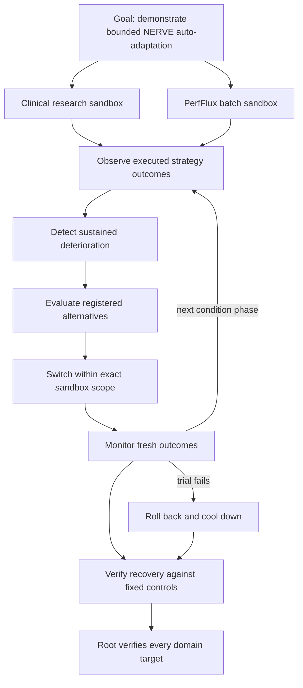

# NERVE auto-adaptation goal and subloops

## Aim and measurable completion target

Connect observation to automatic condition-change detection, candidate evaluation,
scoped strategy switching, and subsequent outcome verification. The parent goal
must demonstrate recovery after two opposite condition changes, retain working
capabilities, survive restart, and roll back a failing candidate trial.

The implemented goal is `auto-adapt-aba-v1`. It is a bounded sandbox adaptation
goal, not a production activation request. It supervises both Clinical OS research
retrieval and PerfFlux CPU batch examples. Each domain has three chronological
condition phases, five subloops per phase, and an independent recovery verifier.
The root verifier depends on both domain verifiers. All leaves must finish with
validated receipts before their parent can complete.



## Detailed subloop contract

| Subloop | Missing connection it resolves | Work and evidence | Completion rule |
|---|---|---|---|
| L0: scope and checkpoint | Separate learning reports have no continuing policy state | Initialize explicit domain, registered strategies, version, baseline, trial and cooldown counters; persist through the existing goal checkpoint | Correct protocol and domain; existing goals cannot be silently reinterpreted |
| L1: observe | Executions do not update a decision-bearing state | Execute current strategy before receiving independent outcome; attach unique event ID, timestamp, scope, strategy and version | Validate chronological, scoped feedback; identical retries are idempotent, missing labels remain unknown |
| L2: detect | Forecast changes do not trigger adaptation | Reuse the existing rolling outcome forecast; inspect the last four known outcomes under the current policy version | A healthy initial baseline of at least 3/4, then at most 1/4 successes; no active trial, cooldown, kill switch or exhausted switch budget |
| L3: evaluate | Deterioration has no measured alternative | Evaluate every registered strategy on four fresh selection tasks and four retained tasks | Strict selection improvement with zero per-task regressions relative to incumbent; independent Boolean judge; no duplicate selection/retention payloads |
| L4: switch | Qualified proposal does not change subsequent execution | Bind evaluation to exact scope, version, incumbent and observation digest; recheck evidence; save prior strategy; increment policy version | Only a registered candidate can become active; eight-observation trial and cooldown start; maximum four switches |
| L5: monitor | Adoption has no continuing feedback or rollback | Execute next eight tasks using the persisted strategy; apply each outcome before the next task | Two failed trial outcomes revert to the previous strategy, increment version, and start an eight-observation cooldown |
| L6: recover under another change | One improvement does not show ongoing adaptation | Repeat L1–L5 for the next unseen-to-controller condition phase | Restore 8/8 monitoring successes after each main-stream change, including returning to the original strategy |
| L7: independent fault trial | Rollback can be merely an untested flag | In a separate sandbox, reverse the environment during the candidate trial; execute through the rollback | Exactly one rollback, previous strategy restored, remaining tasks execute through it |
| L8: verify parent goal | Finished commands can be mistaken for achieved adaptation | Aggregate operational outcomes, fixed controls, policy versions, switch count and fault receipts | Both domains beat every fixed strategy on the same operational task stream, recover in all phases, switch twice, and pass rollback verification |

Every phase declares `observe → detect → evaluate → switch → monitor` dependencies.
A no-change detection is a valid result: evaluation records `no_change_trigger`
and switching retains the incumbent. Failed operational tasks are observations,
not reasons to stop the supervisor before it can adapt. Failed target validators,
exceptions, interrupted execution, cancellation, and budget exhaustion cannot
count as successful goal completion. Evaluation leaves have one attempt.

## Protocol and evidence

The test stream is A → B → A. Each phase has four operational observations and
eight fresh monitoring tasks. Evaluation uses separate tasks only after a trigger.
Phase identifiers and future labels never enter the controller or detector.
The benchmark generator knows the schedule; the controller sees only observations.

- Clinical OS: synthetic public research metadata alternates whether the title
  or abstract is informative. The tools are existing field-overlap retrieval.
- PerfFlux: exact SHA-256 batches alternate between zero-cache workloads and
  repeated-payload workloads with a four-hash budget. The tools are direct and
  memoized execution. The constraints are explicit synthetic task requirements,
  not empirical hardware measurements.
- Retained cases are tasks both registered strategies can already solve.

Each domain achieves 28/36 operational successes; the two fixed strategies achieve
24/36 and 12/36. The eight failures before recovery are included, not discarded.
All three monitoring windows achieve 8/8. There are two automatic switches,
including switching back. The separate fault trial fails twice, rolls back,
then succeeds six times. A policy aware of the environment could do better:
this is not a claim of optimality or superiority over a capable contextual router.

Adaptive selection incurs 32 additional execution calls per domain. Fixed controls
share the operational task stream but do not pay that adaptation cost. These are
accuracy/recovery comparisons, not equal-total-compute or cost-saving claims.
Thresholds and task families are designed demonstrations, not statistical evidence
of broad generalization. Repeated fixture templates are not new independent studies.

## Run, monitor, resume, stop

```sh
PYTHONPATH=src python -m nerve_awim auto-adapt run --state /tmp/nerve-auto-adapt
PYTHONPATH=src python -m nerve_awim auto-adapt status --state /tmp/nerve-auto-adapt
PYTHONPATH=src python -m nerve_awim auto-adapt tick --state /tmp/nerve-auto-adapt
PYTHONPATH=src python -m nerve_awim auto-adapt cancel --state /tmp/nerve-auto-adapt
```

The Agent OS bridge exposes `auto-adapt-run`, `auto-adapt-tick`,
`auto-adapt-status`, and `auto-adapt-cancel`. Application repositories expose
`python scripts/nerve_auto_adapt.py run --state <private-local-directory>`.
`tick` checkpoints a single subloop. A new process resumes from the last verified
receipt, including a switch whose monitoring subloop has not yet run. A completed
goal returns its evidence without rerunning experiments.

## Host boundaries and remaining production connections

The reusable state machine accepts trusted host-executed outcomes, registered
strategy callbacks, and independent judges. The goal checkpoint owns persistence;
there is no additional application database, background scheduler, remote command
execution, or generated-code activation. Checkpoint storage is a trusted local
boundary. The supervisor cannot interrupt arbitrary callbacks; hosts must enforce
I/O timeouts. Cancellation takes effect between ticks.

This closes the observation-to-switch connection inside the sandbox goal. Live
deployment still requires real task intake, authenticated scope mapping, validated
outcome labels, an approved strategy registry, domain-specific resource accounting,
and a host scheduler invoking bounded ticks. Those are not authorized by a
forecast or a synthetic benchmark. The implementation does not automatically
rewrite clinical treatment decisions or control GPU hardware.

The detector requires a healthy initial baseline. An initially failing strategy
needs the existing improvement/bootstrap workflow first. Missing feedback cannot
establish recovery, and four switches or 2,000 events exhaust this bounded state.
Production drift thresholds, trial sizes, and observation delays require separate
validation on representative data. Stable-stream, insufficient-feedback, stale
evidence, duplicate-event, regression, cooldown, kill, and restart tests accompany
the positive adaptation demonstration.
