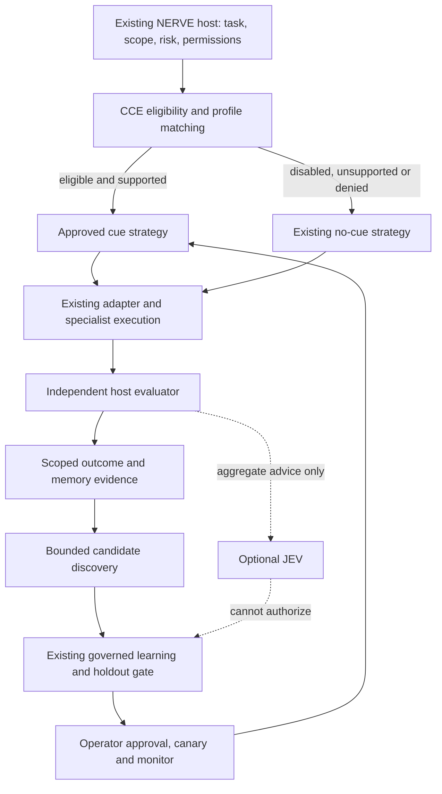

# CCE architecture and integration decisions

Discovery baseline: NERVE commit `a4942ea01fe89e0b1051370f655bea4f338eedea`, inspected 2026-10-12. This inventory describes observed interfaces, not a claim that every connection below is deployed. See [implementation plan](implementation-plan.md) for completion gates.

## Existing surfaces

| Concern | Observed implementation | CCE integration decision |
| --- | --- | --- |
| Agent routing | `src/nerve_awim/agents_v30.py:Coordinator.dispatch`; `collaboration_v31.py` | Preserve routing ownership. The v3.0 agents are numeric simulation agents and explicitly have no LLM connection. Do not claim they accept prefills. |
| Governed executable routing | `governed_learning_v20.py:GovernedLearning`, `agent_learning_v12.py:RegisteredStrategy` | Register bounded cue/no-cue strategies with the existing host. Reuse train, freeze, holdout, approval, release and rollback lifecycle. |
| Trusted capabilities | `governed_learning_v20.py:LearningAuthority`; `memory_v18.py:MemoryAuthority` | Hosts issue roles; cue proposals and agent output cannot mint authority. Local object capabilities are not network authentication. |
| Hermes | `hermes_agents.py:HermesAgentRuntime.execute`; `hermes_learning.py:propose_and_evaluate` | Reuse existing research, skill-builder, evaluator and experiment-runner roles for bounded proposal data. Host keeps independent grading and activation. No duplicate agent scheduler. |
| Model transport | `llm_agent_v14.py:ChatCompletionsPlanner`, `arc_provider.py`, `agentos_claude.py` | Existing chat planner accepts a narrow synthetic tool-selection task. Treat completion-prefill support as an explicit adapter capability; no inferred support from a model name. |
| JEV | `jev_optional.py:JevResearchReviewer.review`; `jev_agreement_v12.py`, `jev_batch.py` | Advisory review remains optional and aggregate-only. Its existing fixed metrics describe simulation outcomes, so reasoning metrics require a separately validated projection or dedicated advisory schema. Never pass raw tasks or expected answers. |
| Memory | `memory_v18.py:TrustedMemoryLedger`; `adaptive_memory.py:OutcomeMemoryRanker`; `skill_proposals.py` | Store scoped cue proposals and provenance using existing ledger approval/revocation. Outcome evidence must come from host grading. |
| Iterative learning | `improvement_loop.py:run_improvement_loop`; `learning_study.py`, `skill_validation.py` | Reuse bounded search with training/selection/final separation. Persistent holdout nonreuse remains a host responsibility. |
| Research evolution | `recursive_evolution_v19.py`, `worldcore_recursion_v19.py`, `research_checkpoint_v19.py` | Preserve existing research coordination; CCE produces candidates and evidence, not a second release controller. |
| Shadow/canary | `shadow_learning_v21.py:ShadowLearning`; `canary_learning_v23.py:CanaryLearning`; `promotion_monitor_v24.py:PromotionMonitor` | Stage eligible registered strategies through existing operator-governed lifecycle. These modules currently target repository tasks, so live model traffic integration needs dedicated evidence. |
| Host/API | `repository_host_v25.py:RepositoryHost`; `bound_repository_host_v26.py`; `oidc_v27.py` | Keep authentication and trial binding at the existing host. Do not expose cue approval or authority issuance through a new unauthenticated endpoint. |
| Operational persistence | `store_recovery_v27.py`, `host_lease.py`, `runtime_v28.py`, `telemetry_v29.py` | Reuse operational patterns for atomic persistence, bounded telemetry and recovery; prove CCE restore behavior before deployment. |
| Agent OS feedback | `agentos_learning.py:AgentOSLearning.observe` | This implementation grades a specific evidence-handoff schema. Do not reinterpret its rewards as general reasoning accuracy. Use a dedicated host-evaluated CCE context. |

## Intended flow



This diagram is the target contract. Completion is established by executable tests and observed run artifacts, not by arrows. Clinical requests remain outside this research deployment unless an independently authorized clinical host supplies its own policy and approval controls; adding a cue is never an authorization decision.

## Added local CCE interfaces

The implementation now adds the following local interfaces. Their presence is source evidence; the coordinator's verification report records test outcomes separately.

| Module | Actual interface | Boundary |
| --- | --- | --- |
| `cue_engine.py` | `ModelProfile`, `Cue`, `CueRegistry`, `CueRouter`, `inspect_tokenization` | Exact profile hash includes capabilities and template revision. Router defaults disabled; token inspection measures cue text only, not complete prompt-boundary tokenization. |
| `cue_evaluation.py` | `DatasetManifest`, `ModelParity`, `Observation`, `PairedResult`, `evaluate_pairs`, `promotion_decision`, `discover_candidates` | Paired evidence and advisory eligibility. Hermes discovery uses the existing `research` role through a callback. Eligibility requires independent evidence; receipts are host attestations, not signatures. |
| `cue_experiment.py` | `ExperimentTask`, `ProviderRequest`, `ProviderReceipt`, `JudgeReceipt`, `run_experiment` | Injected trusted provider and independent grader. Expected answers go only to the judge; reports omit task instructions and generated outputs. Host enforces actual remote billing, timeout and isolation. |
| `cue_learning.py` | `GovernedCueCoordinator` | Uses an existing `GovernedLearning` instance, its capability authority, SQLite database, scope and audit events. Adds cue candidate/partition/route/feedback tables in that same ledger. |

Candidate registration has the signature:

```python
coordinator.propose(
    actor, cue, profile, task_type, manifest,
    generator_id=generator_id,
    model_config=model_parity,
)
```

`model_config` is a preregistered `ModelParity`, including provider/model/tokenizer revisions, template/sampling/context digests, temperature and output-token limit. Evaluation must match the complete preregistered configuration. `evaluate` requires an evaluator capability; `activate` requires an operator capability, expected route generation, reason and bounded lifetime. `select` requires a runtime capability and explicit permission. `feedback` can invalidate a cue but cannot promote it. `export_memory` creates pending evidence in the existing scoped memory ledger.

These route approvals are an adjunct to the same governed ledger, not a new agent scheduler. They do not modify the repository strategy release or automatically enter the existing repository canary pipeline. A production host still needs to connect its execution boundary and traffic controls explicitly. The low-level registry is a trusted-host primitive; calling its `approve` method is not a substitute for the governed coordinator in an application.

The host must authenticate evaluators and bind receipts to the executed candidate, enforce content/family deduplication beyond caller-supplied dataset IDs, and keep clinical risk classification outside untrusted task text. These are integration prerequisites, not guarantees supplied by an in-process callback interface.

## Dependency inventory

The repository is a source-tree Python project using `PYTHONPATH=src`; no root `pyproject.toml`, `package.json` or `Makefile` was present at discovery. The normal suite uses stdlib `unittest`. Existing modules use SQLite, dataclasses, hashing and urllib without a required CCE service dependency. The pilot requirements include `PyJWT[crypto]>=2.10,<3` and a Linux dependency lock under `deploy/`. The principal workflow, `.github/workflows/tests.yml`, uses Python 3.12, installs the OIDC dependency and later the optional pinned MCP SDK, runs the Python suite, a Node checkpoint-discovery test and multiple research scripts. Other workflows cover security, persistence, installation, recursive research and explicitly opt-in live studies.

Hermes is an optional separate Python 3.14 worker pinned by `hermes_agents.py` to revision `c0ef5af5205dbdc25e9e44acd66873b4bb3503c9`. Runtime import is not a sandbox. The worker disables tools and implicit memory/context loading; hosts retain process isolation, credentials and provider-budget responsibility. The CCE should remain importable/testable without Hermes, JEV, GPU packages or credentials.

## Decisions and unresolved boundaries

1. A cue identity must bind exact bytes/token sequence to model revision, tokenizer revision and prompt format. Model aliases alone are insufficient.
2. A capability declaration cannot prove provider behavior. Unsupported assistant prefill must yield a visible no-cue fallback, not a silently substituted system instruction.
3. Discovery proxies nominate candidates. Independent held-out correctness and safety checks decide eligibility; low answer entropy is not confidence or approval.
4. The narrow repository host, simulation coordinator and evidence-handoff learning host serve different contracts. Do not stitch them together by renaming fields.
5. Production endpoint, GPU executor, provider costs and clinician workflow have not been established by repository discovery. Document these as external requirements instead of inventing integration paths.
