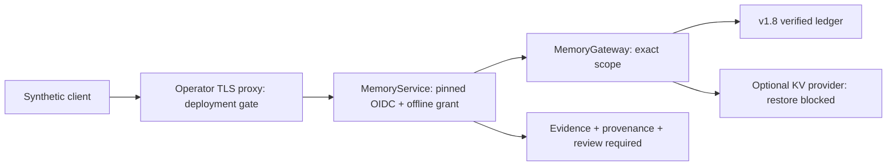

# Version 1 synthetic memory service

Implemented: `memory_gateway/service.py` exposes a WSGI application using the existing operator-pinned `PinnedOIDCVerifier`. `openapi.json` is the versioned route/request/error contract; `memory_gateway/client.py` is a Python reference client. Nothing is deployed.

The host creates `MemoryAuthority` actors offline, constructs `MemoryScope` through `synthetic_scope`, then binds each authenticated subject to one `MemoryGrant`. Scope includes tenant/agent and a canonical hash of application, user, clinic, patient and session. The service never reads tenant/agent/permissions from caller JSON. Caller patient and clinic values must exactly match the offline grant. The host is responsible for constructing the matching scope and clinic/patient grant; service configuration is trusted and never supplied by a request. Different session/user contexts require distinct grants and contexts; multi-context dispatch is deliberately not implicit.

Roles must exist both in the configured grant (`reader`, `writer`, `admin`) and the signed JWT (`nerve-memory-reader`, `nerve-memory-writer`, `nerve-memory-admin`). JWTs require the pinned issuer/audience, supported RS256 key, subject, issued-at and expiry. Actor revocation is checked on every request, including health. Configured grant changes currently require host restart. JWT revocation before expiry requires external identity lifecycle controls.

| Route | Role | Behaviour |
|---|---|---|
| GET /v1/memory/capabilities | reader | Synthetic-only capability metadata |
| GET /v1/memory/health | reader | Gateway/provider readiness |
| GET /v1/memory/metrics | admin | Counters only for the granted scope |
| POST /v1/memory/query | reader | Approved evidence and provenance; review required |
| POST /v1/memory/experiences | writer | Pending episodic proposal |
| POST /v1/memory/feedback | writer | Pending episodic proposal, never approval or score mutation |
| POST /v1/memory/revoke | admin | Revoke one exact-scope record; invalidation status |
| DELETE /v1/memory/records/{id} | admin | Delete one exact-scope local record; invalidation status |
| POST /v1/inference/respond | reader | 501: no inference implementation |

Every POST/DELETE requires `clinic_id` and `patient_id`. Query additionally requires `query` (1–256 characters) and `limit` (1–20). Experiences/feedback require `content` (1–2048 characters) and `source_id`; revoke requires `memory_id`. Delete requires only the two scope fields. Unknown/duplicate fields, incomplete bodies and nonfinite JSON are rejected. JWT authentication occurs before body reads. The service lock protects only atomic per-principal rate accounting; it is never held during client reads, JWT verification or gateway/provider I/O. After a body read, token expiry and actor capability are checked again before parsing or taking action. A stalled authenticated upload therefore cannot monopolise the service lock. The hosting WSGI server still needs concurrent workers and enforced upload deadlines; application code cannot cancel arbitrary blocking input streams. Errors contain stable generic identifiers, no payloads or tracebacks; responses use `Cache-Control: no-store`. Administrative actions still require the relevant host-issued read/approve/delete permissions.

Example synthetic query:

```json
{"clinic_id":"synthetic-clinic","patient_id":"synthetic-patient","query":"fixture","limit":5}
```

Example client (obtain credentials through your separately configured IdP; never hardcode them):

```python
from nerve_awim.memory_gateway.client import MemoryClient
client = MemoryClient("https://your-operator-memory-host.example", token)
result = client.query(clinic_id="synthetic-clinic", patient_id="synthetic-patient", query="fixture")
assert result["review_required"] is True
```

The client accepts HTTPS origins or explicitly enabled loopback HTTP, disables redirects to prevent bearer forwarding and bounds response size/timeout. Run the WSGI application behind a trusted TLS reverse proxy with timeouts, request limits and scrubbed access logs. No public deployment script or automatic service launch is provided.

Independent verification: `PYTHONPATH=src python3 -m unittest discover -s tests -p test_memory_service.py -v`. Tests execute signed JWT requests against the real WSGI boundary and verify pending → offline approval → evidence retrieval → revoke/delete. Keys and stores are temporary. Inference and clinical reasoning remain unimplemented; retrieved evidence is never a diagnosis or treatment recommendation.


