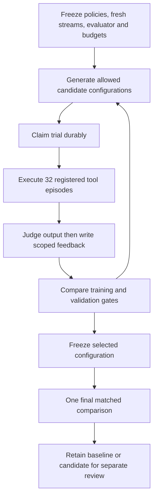

# Automatic online policy selection and final rejection

The previous overnight coordinator replicated one fixed candidate. This change connects NERVE's existing bounded candidate-selection coordinator to prospective outcome-learning trials. It automatically evaluates a bounded parameter grid, selects from training/validation results and freezes that selection before a one-use final comparison. A rejected final candidate never changes the baseline.



The candidate loop is bounded to two generations and seven configurations; it cannot continue indefinitely or repeat consumed data. Within each trial, learning occurs after scoring each actual execution. Final streams permit that same within-stream feedback, while the policy configuration stays frozen. This is prospective evaluation, not a frozen-memory probe and not an independently sealed holdout.

## Implementation and reuse

- `OnlinePolicy` is a frozen allowlisted contract. Each trial reports its actual window, tie breaker and discount. Validation rejects a wrong configuration, forged reward, altered task identity, unexpected feedback or invalid duration.
- The existing online execution path now accepts typed configurations. Historical baseline/candidate/fixed arms delegate to it without changing their settings.
- `policy_research_loop` supports explicit online hits/32-episode metrics while preserving its older five-probe/25-execution mode. Reported counts distinguish pipeline episodes and primitive tool calls.
- Every trial is durably claimed before execution. Completed evidence survives a later failure. Source hashes are checked before and after each child and immediately before successful final persistence.
- The trusted host spawns only the registered evaluator, with a 60-second child timeout and bounded cleanup. No generated code, model-supplied rewards or arbitrary shell commands execute.

The new study tests windows 3/5/10 with discount half-life 3/10, plus the unchanged window-3 undiscounted baseline. Its rationale is retention under noisy outcomes following the overnight mixed-regime regression; no guarantee of improvement is assumed. It uses the same synthetic task family with fresh streams: training seeds 22001–22004, validation 23001–23004, final 24001–24008. These are disjoint from the earlier experiments. Maximum work is 352 trials / 11,264 pipeline episodes / 22,528 primitive invocations. No language-model calls occur.

## Actual results

All **352 trials and 11,264 episodes completed**, with 9,216 verified feedback observations. The coordinator provisionally selected window 3, relevance tie breaking and discount half-life 3. It improved training from 400/512 to 412/512 and validation from 401/512 to 407/512, without a validation-scenario loss. The selection was stored before any final-stream trial.

| Final metric | Baseline | Selected policy |
| --- | --- | --- |
| Total | 815/1,024 (79.59%) | 830/1,024 (81.05%) |
| Stationary | 255/256 | 255/256 |
| Abrupt | 238/256 | 239/256 |
| Recurrent | 146/256 | 163/256 |
| Mixed | 176/256 | 173/256 |

**Decision: retain baseline.** Aggregate gain was 15/1,024, but mixed-regime loss was 3/256. The final results were not used to tune this run again. Fixed lower and fixed trim controls scored 651/1,024 and 373/1,024 respectively; these are deterministic tool controls, not model baselines.

The complete repository suite passed **1,280 tests**, zero failures/errors, in 82.000 seconds. Focused tests include real configurable execution, durable claims, source drift, a final guard failure, forged rewards, immutable selection before final evaluation and scenario-regression rejection. All 352 journal entries are complete; final SQLite report equals the exported artifact, and source hashes were rechecked. Recorded episode execution times sum to 256.991 seconds, excluding process startup, journaling and orchestration. No inference latency, GPU energy or monetary-cost advantage is claimed.

- [Protocol, decisions, summary and integrity hashes](evidence/online-optimisation-v1-summary.json)
- [Complete losslessly compressed report](evidence/online-optimisation-v1.json.gz)
- [Regression evidence](evidence/online-optimisation-validation.json)

The durable journal remains at `/private/tmp/nerve-online-optimisation-v1.sqlite`. Historical studies remain tied to their original source commits; their evidence has not been rewritten after the refactor.

## Reproduction

```sh
cd /Users/aliyildirim/nerve-galahad
.venv/bin/python scripts/verify_galahad.py baseline
PYTHONPATH=src .venv/bin/python scripts/optimise_online_memory.py --database /private/tmp/nerve-online-optimisation-reproduction.sqlite --run-id online-optimisation-reproduction --output /private/tmp/nerve-online-optimisation-reproduction.json
```

Use unused output paths. Repeating published seeds is replication, not fresh final evaluation. Existing ledgers prevent replay of the consumed protocol or dataset. If a run fails, its SQLite trial journal retains the authoritative evidence even if the exclusive output file is empty.

This adds automatic configuration selection to the real outcome-learning path. It does not establish general self-training, broad scientific-discovery competence, a successful policy promotion, real Galahad restoration or clinical deployment. Defaults remain unchanged because the measured candidate failed its acceptance gate.
