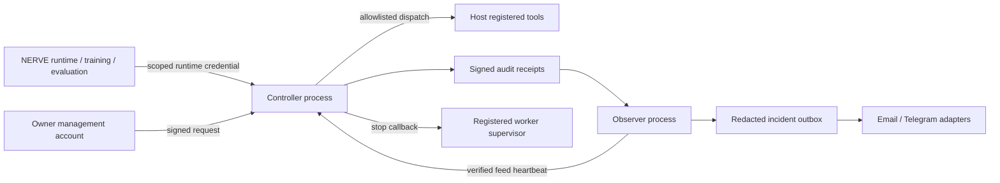

# Independent safety controller: implementation and deployment boundary

NERVE now has an opt-in controller for host-registered tools, an independently
authenticated receipt observer, owner stop/recovery commands, local model
artifact verification, a worker supervisor, and a durable incident outbox.
These controls preserve ordinary authorized learning and do not interpret a
model refusal, uncertainty, or suspicious prose as grounds for stopping all work.

**This implementation has not been deployed as an OS-isolated control plane.**
The tests use separate processes under the same local user. They cannot show
that a learner with that user's full file/process privileges cannot modify or
kill the controller. No hidden capability absence is proved.

## Architecture



The protected tool credentials and handlers belong to the controller, not the
learner. The service has no endpoint for registering tools, executing arbitrary
shell commands, issuing its own permissions, or changing policy from model text.
Its network listener is IPv4 loopback only, with bounded requests, responses,
socket timeouts and concurrent connections. Owner and observer credentials must
never be passed to a runtime client.

`safety_control.integration.bind` stores immutable context/tool/model/endpoint
bindings in the existing learner database. Every registered handler invocation
in `GovernedLearning.execute`, training and candidate evaluation checks these
bindings. Bound handlers run in the controller process; missing adapters, dead
controllers or denials never fall back to the local handler. Existing ARC and
uncertainty checks remain before runtime dispatch. A stopped evaluation aborts
instead of treating a control denial as a negative learning reward.

Unbound contexts retain their current behavior. This is deliberately opt-in;
existing provider calls, scripts and tools outside this governed dispatcher
are **not automatically covered**. Their credentials must be moved behind the
broker before claiming equivalent control over them.

## Implemented controls and evidence

| Requirement | Implemented behavior | Limit |
|---|---|---|
| Model verification | Owner-reviewed local manifest, descriptor-based non-symlink file reads, byte budgets, SHA-256 verification; host binding pins approved digest | No hosted-weight attestation or proof of absent hidden abilities; a runtime-supplied identity alone is not trusted provenance |
| Independent behavioral observation | Separate observer authentication; signed receipts, ordered hash chain, persisted cursor, nonce-challenged audit head and bounded pagination | Observes broker behavior, not arbitrary activity elsewhere on the machine |
| Watchdog | Protected dispatch requires a fresh observer heartbeat; corrupt/missing/replayed audit feed does not refresh it | Failure blocks after the configured timeout, not instantaneously; unbound work continues |
| Tool permission enforcement | Scope, token epoch, model pin and tool allowlist checked in the actual executing controller | Registered host handlers still need deployment-specific argument/effect validation |
| Owner authority | Distinct owner secret; HMAC-signed action/payload/nonce/time; replay and stale-request rejection | Trusted management endpoint and protected secret storage required; not an email/Telegram approval link |
| Emergency control | Durable stop revokes controller-issued credentials before invoking supervisor; stopped-epoch responses discarded | Does not revoke external cloud keys or undo side effects already performed |
| Isolation | Only host-spawned process groups can be terminated; TERM then bounded KILL; global close blocks late launches | Process groups are not a sandbox; escaped descendants and arbitrary host callables require OS-level containment |
| Recovery | Signed reviewed recovery resets liveness and requires new runtime credentials; corrupt audit needs separate repair acknowledgment | No automatic restart or silent restoration of old tokens; no history is erased |
| Incident alerts | Durable per-channel deduplication, bounded retry, redacted metadata/digests; email and Telegram transport adapters | Actual destinations/credentials not configured or sent; bounded at-least-once delivery can duplicate after a transport crash |

Audit corruption cannot prevent an authenticated owner stop. Recovery after an
integrity incident requires restoring valid external evidence, explicitly
acknowledging the repair, and then issuing a separate recovery request. A hash
chain is not tamper-proof against an administrator who can rewrite the entire
database and its anchors; protect and independently archive the observer state.

## Verification loop

Specialist implementation was followed by cross-component review and adversarial
tests. Review repaired three integration issues before final verification:

1. Protect training and holdout handler calls as well as ordinary runtime calls.
2. Keep emergency stop available during audit corruption, and discard results
   that complete after revocation. Close database connections deterministically.
3. Replace unbounded audit-feed reads with authenticated pagination and a fresh
   signed head so long-running observation cannot silently lose an omitted tail.

The standalone controller demonstration runs an actual separate server process,
verifies a local fixture artifact, executes a registered tool, denies a wrong
model and an unregistered tool, lets authorized work continue after warnings,
starts and terminates a disposable worker, and exercises reviewed recovery.
All nine checks pass. Alerts are queued but not sent, and no LLM inference occurs.
The existing six-workstream learning demonstration also remains
`offline_verified` after integration. See `evidence/` and `progress.json` for
the final test counts, source hashes and resumable deployment blockers.

Final local verification: **1,392 regression tests passed with no skips** in
161.205 seconds, followed by **6 additional observer-runner tests** (added after
full-suite discovery), and **7 Node tests**. The
[controller receipt](evidence/controller-demo.json),
[regression log](evidence/full-tests.log),
[source manifest](evidence/source-manifest.json), and
[resumable progress](progress.json) preserve the evidence. This is a protocol and
integration test result, not an independent security certification or an
evaluation of actual models for concealed capabilities.

## Reproduce locally

```bash
PYTHONPATH=src python -m unittest discover -s tests -p 'test_safety*.py' -v
PYTHONPATH=src python -m nerve_awim safety-control doctor
PYTHONPATH=src python -m nerve_awim safety-control demo \
  --directory /tmp/nerve-safety-new-run
PYTHONPATH=src python -m nerve_awim integrated-learning \
  --repository . --directory /tmp/nerve-learning-after-safety-new-run
```

Use fresh output directories. The tests need local socket and subprocess
permission. Python 3.12 was used for verification. No paid calls or production
process termination is part of these commands.

## Host integration

The deployment host constructs `Controller(database, owner_secret,
observer_secret, isolation_callback=supervisor.close)`, registers trusted tool
callables with `register_tool`, and serves `make_server(controller)` in its
separate control account. Model artifacts must be verified against a reviewed
manifest before issuing the allowed digest. The host signs `issue_runtime` with
the exact `{tenant, agent, context}`, approved tool names and model digests.
Only that returned runtime credential enters `RuntimeClient`.

In the existing NERVE host, attach the client to the operator-approved context:

```python
from nerve_awim.safety_control.client import RuntimeClient
from nerve_awim.safety_control.integration import bind

bind(engine, operator, context, RuntimeClient(endpoint, runtime_credential),
     model_digest=verified_manifest_digest,
     tools={strategy_id: controller_registered_tool})
```

All registered strategies for that context need an explicit tool mapping. The
learner database stores no runtime secret. Restart reattachment must match the
immutable binding. Owner-reviewed credential replacement can use the same
binding after recovery. A closed worker supervisor needs a newly reviewed host
instance before it can launch workers again.

The observer host runs `BehaviouralObserver.poll(ObserverClient(...))` on a
schedule shorter than the controller watchdog. It owns a separate cursor and
outbox database. Notification delivery is a separate trusted process using
`DurableAlertOutbox.deliver` with configured transports. Channel messages and
replies have no path to approval or recovery.

The standalone observer runner is available for that separate service identity:

```bash
python scripts/nerve_safety_observer.py \
  --endpoint http://127.0.0.1:CONTROL_PORT \
  --observer-key-file /protected/observer.key \
  --state-directory /protected/observer-state --continuous --interval 5
```

Without `--continuous` it runs once; `--iterations N` runs a finite number of
polls. State directories must be private to the observer account. Failed polls
emit sanitized errors and never mint replacement heartbeats. This runner queues
notifications but does not send them.

Owner commands use a private owner-owned regular key file (mode `0600`, no
symlinks), rather than putting a secret on the command line:

```bash
PYTHONPATH=src python -m nerve_awim safety-control stop \
  --endpoint http://127.0.0.1:CONTROL_PORT \
  --owner-key-file /protected/owner.key --reason 'Incident reference'

PYTHONPATH=src python -m nerve_awim safety-control recover \
  --endpoint http://127.0.0.1:CONTROL_PORT \
  --owner-key-file /protected/owner.key \
  --reason 'Containment verified' --review-ref 'Independent review reference'
```

If an audit integrity incident was latched, use the separate
`acknowledge_integrity_repair` action with a reason and review reference after
restoring valid evidence, before requesting recovery. This command does not
repair, delete or rewrite the evidence itself.

## Deployment work still required

The learner must have no write access to controller code, policy, databases,
observer cursor/keys or management credentials; no right to signal the controller
or observer; and no alternate access to protected tool/provider credentials.
Use separate OS/service identities and OS-enforced filesystem, process and
network restrictions. The current same-user Mac research environment does not
meet that boundary. No users, firewall rules, services or provider keys were
changed by this implementation.

The owner shares the bounded local listener with runtime traffic. Dedicated
management access, rate limits, durable external audit anchoring, provider-key
rotation, restart supervision and deployment-specific isolation tests remain
needed for stronger availability and containment guarantees. No continuous
self-modification of these controls is authorized. Learning may propose changes,
but it cannot approve or install changes in the independent control plane.

The design follows execution-side authorization and least privilege described
in the [OWASP AI Agent Security Cheat Sheet](https://cheatsheetseries.owasp.org/cheatsheets/AI_Agent_Security_Cheat_Sheet.html),
and independent review, monitoring, incident response and recovery in the
[NIST AI RMF Core](https://airc.nist.gov/airmf-resources/airmf/5-sec-core/).
These are design references, not a certification or claim of compliance.
