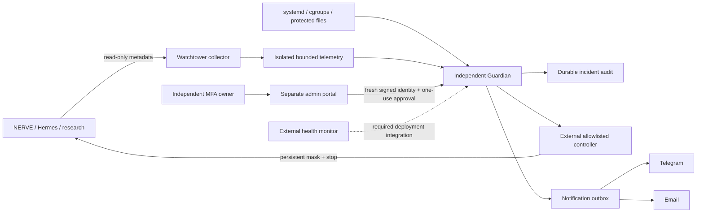

# Independent safety control plane

`safety/nerve_guardian` is independently packaged and has no import dependency on NERVE. No runtime learning path calls Guardian. Passive metadata collection is bounded and loss is observable. Behavioral anomalies produce NOTICE/WARNING; only fresh independent invariant measurements may become CRITICAL.

Deployment must place immutable safety code/config, service credentials, audit anchor and controller privileges outside the NERVE user/container filesystem and administration. Separate repository directory alone is not a security boundary. Installation templates are inert and not production authorization. The local demonstration uses synthetic telemetry and a disposable external process supervisor; real Linux systemd, IdP, messaging and IAM integration have separate evidence gates.

Restart is incident-scoped, authenticated server-side, fresh-MFA-only, replay-protected and checked against current infrastructure/integrity before any start. The controller retains a durable stopped latch independent of application state. Systemd containment covers only explicitly inventoried nonclinical units and their cgroups. CI, launchd, remote workers, unmanaged egress, tokens and deployment credentials remain uncovered unless separately administered controls are installed.
